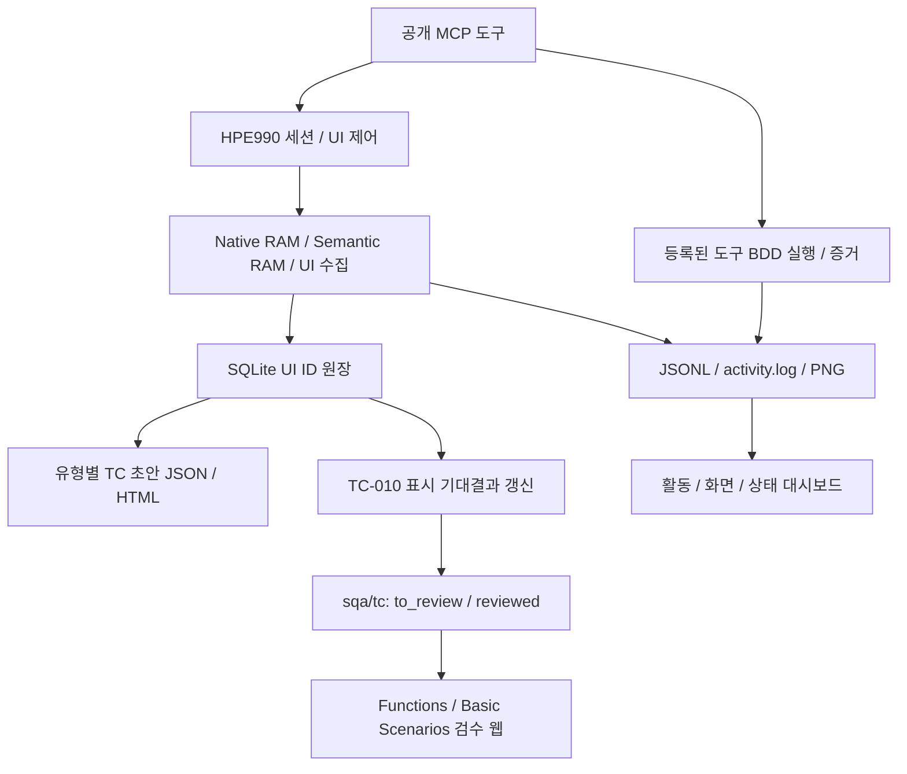

# tc_adder_from_real_user_monitoring

HPE990 PC Emulator의 UI를 관찰하고, 수집한 요소를 바탕으로 테스트 케이스(TC) 초안을
생성·검수하는 Windows 프로젝트입니다. 현재 구현 애플리케이션 이름은 `auto_emulator`입니다.
MCP로 앱 실행·UI 수집·입력·관측·BDD 실행을 연결하고, 웹에서 TC와 활동 증거를 확인합니다.
Python은 uv로 관리하며 지속 창 이벤트·화면 해시 수집과 입력 처리는 Rust로 구현합니다.

수집한 UI ID → 입력유형별 Steps / Expected Result 초안 → Gherkin TC → 검수 웹으로
이어집니다. 자동 생성은 수집한 표시 요소와 템플릿에 근거하며, 미관찰 기능의 동작을
확정하거나 검수 TC를 자동으로 실행 가능한 테스트로 승격하지 않습니다.

전체 기능 명칭은 **UI Automation & Observability**입니다. 책임 경계의 정본은
[automation_observability.py](cores/hpe990/rules/automation_observability.py)입니다.

| 구성 | 책임 | 현재 구현 |
|---|---|---|
| UI Automation | 화면·버튼 수집, 식별, 이동, 입력, 결과 확인 | MCP UI 도구; 전체 화면 커버리지는 미검증 |
| UI observation | 창·화면 변화, 샘플링 상태·공백, 증거 기록 | 기존 Real Activity Monitoring·semantic Real Activity Monitoring·telemetry |
| RUM | 실제 사용자 세션의 응답 시간·앱 오류·사용 경험 지표 | `NOT_IMPLEMENTED`; 실제 사용자 출처와 응답 계측 필요 |

자동화 입력은 automation 출처이며, 출처를 모르는 창 이벤트는 실제 사용자 데이터로
간주하지 않습니다. RAM의 샘플링·처리 시간은 RUM 응답 시간 지표가 아닙니다.
기존 `hpe990_ram_*` 이름과 증거 경로는 UI 관측 구현 식별자로 유지합니다.

## 주요 기능과 데이터 흐름

| 기능 | 동작과 결과 | 구현 근거 |
|---|---|---|
| 앱 세션 관리 | 바로가기 실행, Continue → Edger 준비 확인, 세션 재사용, 소유한 앱 종료 | [lifecycle.py](cores/hpe990/functions/lifecycle.py) |
| UI 수집·식별 | HWND·접근성·OCR·입력란 후보·PNG/해시 수집, SQLite에 영속 `UI-*` ID 부여 | [ui.py](cores/hpe990/functions/ui.py), [ui_identity.py](cores/hpe990/functions/ui_identity.py) |
| 관찰과 활동 기록 | Native RAM, 텍스트·값·RGB 변화 관측, JSONL과 timestamp `activity.log` | [monitoring.py](cores/hpe990/functions/monitoring.py), [semantic_ram.py](cores/hpe990/functions/semantic_ram.py), [activity_log.py](cores/hpe990/functions/activity_log.py) |
| 관찰한 UI 제어 | 클릭·문자 입력·스크롤·드래그·키 조합·활성화·최소화, 입력 전후 관찰 증거 | [MCP UI 도구](cores/hpe990/mcp/tools/ui.py) |
| UI별 TC 초안 | UI ID와 유형별 템플릿을 연결해 사전조건·Steps·Expected Result 및 JSON/HTML 생성 | [step_templates.py](cores/hpe990/functions/step_templates.py), [템플릿 설정](cores/hpe990/configs/ui_step_templates.json) |
| 수집 항목 동기화 | 명시된 General 표시 기대결과 영역만 UI 원장으로 갱신, 검수 완료 파일 보호 | [tc_dynamic.py](cores/hpe990/functions/tc_dynamic.py) |
| TC 저장·검수 | TC당 독립 Gherkin 파일, 폴더로 검수 상태 결정, Functions / Basic Scenarios 탐색·검색·SSE 갱신 | [tc_repository.py](cores/hpe990/functions/tc_repository.py), [검수 렌더러](cores/hpe990/scripts/render_tc_review.py) |
| 시각화 | 활동 타임라인·화면 갤러리·모니터링 상태·BDD 시나리오를 한 대시보드에서 조회 | [ui_viewer.py](cores/hpe990/functions/ui_viewer.py) |
| BDD와 추적성 | 도구 BDD 등록 조회·공개 MCP 실행, 관찰한 상태 전이와 시나리오 연결 | [scenarios.py](cores/hpe990/functions/scenarios.py), [공통 BDD 실행기](cores/common/functions/run_family_bdd.py) |



UI별 초안은 검토 후 TC 정본에 반영합니다. `reviewed`는 문서 검수 상태이며 BDD PASS가
아닙니다. 초안 생성·검수·자동 실행은 각각 별도 단계입니다.

### 분석 시점의 확인 범위

Graphify로 코드 118개와 문서 56개를 분석한 뒤, 실제 stdio MCP 연결의 `list_tools`와
읽기 전용 공개 도구 호출로 아래 수치를 확인했습니다(2026-10-16).

| 항목 | 확인 결과 | 해석 |
|---|---|---|
| 공개 MCP | 38개 도구 | [operation 매핑](cores/hpe990/functions/operations.py)과 실제 discovery 일치 |
| auto_emulator BDD | 8개 등록 | `hpe990_bdd_catalog`; 이 문서 갱신에서 실행한 결과는 아님 |
| HPE990 제품 목록 | 196개: 바인딩 workflow 1개 + 검수 TC 195개 | `hpe990_bdd_list`; 검수 TC는 `unbound`, 응답은 `NOT_RUN` |
| 실제 사용자 계측 | `NOT_IMPLEMENTED` | `hpe990_rum_status`; 사용자 세션 출처·응답 시간·앱 오류 상관 계측 필요 |

Graphify의 함수·호출 관계는 구현 파일과 대조했습니다. `.feature`와 JSON 설정은 Graphify
분류 대상에서 빠져 원문과 MCP 응답으로 보완했습니다. 그래프의 미해결 참조와 관계 병합이
있으므로 정적 분석을 전체 기능의 실행 검증으로 간주하지 않습니다. 이번 문서 갱신에서는
앱 입력·BDD 실행·EXE 재빌드를 수행하지 않았습니다.

그래프의 주요 연결점은 `session_guard()`(33개 연결), `ram_status()`(29개),
`load_review_source()`와 `collect_ui()`(각 27개)입니다. UI 제어가 세션·관찰 상태를
확인하고, 검수 웹과 제품 목록이 TC 정본 로더를 공유하는 구조를 보여 줍니다.
`collect_ui() → sync_general_expected()` 호출과 공유 웹의
`watch_dashboard() → monitoring_viewer_data()` 호출을 확인하여 자동 기대결과 갱신과
대시보드 재사용 흐름을 위 기능 설명에 반영했습니다.

## 소스에서 시작하기

Windows 대화형 데스크톱, HPE990 설치, Python 3.13 환경을 관리할 uv가 필요합니다.
Rust 도우미를 빌드하려면 Cargo와 Windows 링커도 필요합니다.

```powershell
uv sync --locked
uv run python cores/hpe990/wrapper/emulator.py status
uv run python cores/hpe990/wrapper/emulator.py
# MCP 클라이언트 연결용 stdio 서버
uv run python cores/hpe990/mcp/server.py
# TC 검수 웹: 이 PC에 실제 할당된 LAN IP를 지정
.\scripts\tc-review.cmd --bind <LAN-IP> --port 9999
```

`status`는 상태 조회이고, 인자 없는 wrapper 실행은 앱을 실행합니다. MCP 설정 예시는
[.mcp.json](.mcp.json)에 있습니다. 서버 작업 디렉터리는 이 저장소 루트로 지정합니다.
`uv`가 PATH에 없으면 해당 실행 파일의 절대 경로를 사용하세요. `tc-review.cmd`는
`UV_EXE`도 지원합니다. `ModuleNotFoundError: cores.hpe990`가 발생하면 `PYTHONPATH`에
다른 저장소의 `cores` 패키지 경로가 들어 있는지 확인하고 제거한 뒤 실행합니다.

## 실행

배포 위치는 프로젝트 상위 **`3rd_party/auto_emulator_X.Y.exe`**, 고정 실행 파일은 `3rd_party/auto_emulator.exe`입니다.
정식 버전과 SHA256은 `cores/hpe990/configs/releases.json`의 `released` 기록을 확인하세요.
Python을 별도로 설치하지 않아도 배포 EXE의 MCP 서버와 내장 BDD 실행기를 사용할 수 있습니다.
HPE990 설치, Explorer 및 Windows 대화형 데스크톱은 필요합니다.

```powershell
..\auto_emulator.exe
..\auto_emulator.exe status
..\auto_emulator.exe --mcp
```

기본 실행 범위는 **HPE990 실행 → Continue 클릭 → Edger 확인**이며 RAM도 자동으로 시작합니다.
대상은 공용 시작 메뉴의 `Huvitz_pc/HPE990/HPE990.lnk`로 고정되어 있습니다.
Qt의 `QT_USE_NATIVE_WINDOWS=1`을 실행 자식에 적용해 컨트롤을 식별합니다.
반복 실행은 동일 세션을 재사용합니다. Explorer가 실행한 별도 도우미 덕분에 MCP 연결 종료 후에도
앱과 RAM이 유지됩니다. `session_id`는 실행 결과에서 확인하세요.

## MCP 도구

TC 검수 트리는 버전 아래 `Functions`와 `Basic Scenarios`로 나뉩니다. 독립 기능 TC는
`Functions` 바로 아래 `TC-ID 화면 suite 경로 — 제목` 형식으로 표시하고, Job 흐름의
기준·결과 TC와 Tester 수행 순서는 `Basic Scenarios > Job > Scenario`에 둡니다.
각 Job 단계와 TC는 양방향 링크로 연결되며 TC 본문을 중복 저장하지 않습니다.

| 기능 | 도구 |
|---|---|
| 수집 UI 식별자·화면 이미지·해시·품질 검증 | `hpe990_ui_collection_audit` |
| 자동화·관측 책임 경계 / RUM 계측 상태 | `hpe990_automation_observability_status`, `hpe990_rum_status` |
| 실행 / 상태 / 정상 종료 요청 / 명시적 앱 종료 | `hpe990_launch`, `hpe990_status`, `hpe990_close`, `hpe990_stop` |
| Real Activity Monitoring 시작 / 상태 / 정리 | `hpe990_ram_start`, `hpe990_ram_status`, `hpe990_ram_stop` |
| 입력값·문구·RGB 변화 Real Activity Monitoring (소스 MCP) | `hpe990_ram_semantic_start`, `hpe990_ram_semantic_status`, `hpe990_ram_semantic_read`, `hpe990_ram_semantic_stop` |
| 창·모달·컨트롤·스크린샷 / 수집 목록 | `hpe990_ui_collect`, `hpe990_ui_catalog` |
| 활동·화면·상태·BDD 대시보드 / 뷰어 서버 정리 | `hpe990_ui_visualize`, `hpe990_ui_viewer_stop` |
| 식별한 컨트롤 입력 / 창 이동·크기 | `hpe990_ui_control`, `hpe990_window_geometry` |
| native UI ID 드래그 (소스 MCP) | `hpe990_ui_drag` |
| native UI ID 키 조합 / 활성화 / 최소화 (소스 MCP) | `hpe990_ui_keys`, `hpe990_ui_activate`, `hpe990_window_minimize` |
| 재수집한 OCR UI ID 클릭 / 입력 후보 조회 (소스 MCP) | `hpe990_ui_control_visual`, `hpe990_ui_input_inventory` |
| 정본 UI ID·할당 카운터·의미 매핑 백업 (소스 MCP) | `hpe990_ui_registry_backup` |
| 버전별 UI 이름·의미 ID MAP / 현재 대상 해석·제어 | `hpe990_ui_map`, `hpe990_ui_resolve`, `hpe990_ui_control_semantic` |
| 로컬 이벤트 읽기 / 검증·내보내기 | `hpe990_telemetry_read`, `hpe990_telemetry_export` |
| 상태·전이 분석 / 시나리오·추적표 / 실제 BDD 실행 | `hpe990_ui_analyze`, `hpe990_bdd_catalog`, `hpe990_bdd_run` |
| HPE990 제품 BDD 목록 | `hpe990_bdd_list` |
| UI ID별 Steps / Expected Result 초안 생성 | `hpe990_tc_templates` |
| HTTP MCP 서버 시작 / 종료 / 재시작 | `mcp_server_manager` |

`mcp_server_manager`는 별도 loopback HTTP 서버를 관리합니다. `action`은 `start`, `kill`,
`restart` 중 하나이며 연결 주소는 `http://127.0.0.1:8765/mcp`입니다. 기본 stdio MCP 연결은
계속 살아 있으므로 재시작 명령도 같은 연결에서 호출할 수 있습니다. `--mcp-http`를 직접 실행해도
같은 HTTP 엔드포인트를 제공합니다.

컨트롤은 현재 세션의 이름·HWND·부모 창으로 지정합니다. 중복 이름은 `root_hwnd` 또는 `hwnd`로
구분하고, 화면 좌표 대신 필요시 컨트롤 내부 `point_fraction`을 사용합니다. 모든 입력 전후에
Real Activity Monitoring 승인 기록과 화면 증거를 남깁니다. 텍스트 원문은 제어 로그에 저장하지 않습니다.

`hpe990_bdd_run`의 `allow_desktop_input: true`는 실제 앱을 실행·제어·종료합니다.
외부에서 실행한 세션의 종료는 거부합니다. Edger는 WM_CLOSE를 무시하므로 `hpe990_close`가
`closed: false`를 반환할 수 있습니다. `hpe990_stop`의 **명시적 `force: true`**는 소유한 HPE990
프로세스만 종료하며 `exit_method: explicit_force`로 기록합니다. 시스템 Shutdown 확인창은
테스트에서 취소하며 Windows 종료 성공으로 보고하지 않습니다.

루트 `.mcp.json`은 uv 소스 서버 설정입니다. uv가 PATH에 없으면 클라이언트에서 실행 파일 경로를
지정하세요. 배포 EXE를 연결하려면 `auto_emulator.exe`의 절대 경로와 `--mcp` 인자를 사용하세요.

## 개발·검증·one shot

시나리오는 검증 대상별로 구분합니다.

| 검증 대상 | 정본 위치 | 상태 |
|---|---|---|
| auto_emulator 도구 기능 | `cores/auto_emulator/tests/bdd/` | 8개 BDD와 바인딩을 `cores/auto_emulator/configs/one_shot_bdd.json`에 실행 등록 |
| HPE990 제품 기능 | `sqa/tc/to_review/`, `sqa/tc/reviewed/` | 화면 계층별 TC와 검수 상태 관리 |

도구 검증은 HPE990을 실행 대상으로 사용합니다. 기존 `hpe990_bdd_catalog`와
`hpe990_bdd_run` MCP 도구는 `auto_emulator` family의 등록 목록과 실행기를 연결합니다.

`hpe990_bdd_list {}`는 HPE990 제품 BDD를 실행 없이 조회합니다. 등록된 Gherkin의
`@product-hpe990` 태그로 Workflow를 분류하고, 같은 검수 웹의 TC 원본을 함께 읽습니다.
각 항목은 단계와 태그를 포함하며, `automation_status`는 실행 바인딩이 있는 `bound`와
검수 TC의 `unbound`를 구분합니다. 검수 상태는 실행 결과가 아니며 조회 결과의
`execution_status`는 `NOT_RUN`입니다. Workflow 실행 바인딩은 기존 실행 suite에 유지합니다.

TC 작성 규칙과 예시는 [tc_format.py](cores/hpe990/rules/scenarios/tc_format.py)의 `BODY`를
따릅니다. General TC 작성 결과는 [preferences_general.md](cores/hpe990/docs/bdd/preferences_general.md)에서 확인합니다.
`uv run python -m cores.hpe990.scripts.render_tc_review`는 같은 Gherkin 초안으로
`{D_TEMP}/hpe990/evidence/093ca349/preferences-general-tc-review.html`을 생성합니다.
TC별 No. / Steps / Expected Result 표와 입력 즉시 반영되는 퍼지 검색을 제공합니다.
TC ID·제목·Steps·Expected Result를 검색하며 공백으로 구분한 검색어는 모두 일치해야 합니다.
예: `lng`는 Language, `beep off`는 Beep Sound의 OFF 관련 TC를 조회합니다.
관련도 순으로 정렬하며 검색창에서 ↑/↓로 선택하고 Enter로 해당 TC에 이동합니다.
공유 검수 웹은 버전 아래 `Functions`와 `Basic Scenarios`를 표시합니다.
`Functions` 항목에는 TC ID·화면 경로·제목을 함께 표시하고, Basic Scenarios에는 Job 수행 순서와 TC 링크를 표시합니다.
TC ID는 경로와 독립적으로 관리하며 Gherkin의 `@path-Setup/Preferences/General` 태그가 트리 경로를 지정합니다.
검색 시 일치하는 가지를 펼쳐 검색어를 강조하고, 선택 항목을 강조합니다.
미확정 사항은 `지원 언어 미확정`, `최소·최대값 미확정`, `입력유형 미확정` 등의 구체적인 칩으로 표시합니다.
칩은 Gherkin의 `@spec-*` 태그에서 생성하며 좌측 트리와 TC 제목 우측에 동일하게 표시합니다.
검색은 공백 AND, `|` OR, `!` 제외, `^` 접두, `$` 접미, `'` 정확 부분 문자열을 지원합니다.
검수 상태는 `sqa/tc/to_review/`와 `sqa/tc/reviewed/`의 파일 위치가 정본입니다.
TC 하나는 `.feature` 파일 하나에 저장하며, 검수 완료 TC는 자동 기대결과 갱신에서 보호합니다.
수동 HTML 생성 후에는 다시 생성해야 하고, 공유 서버에서는 변경이 자동 반영됩니다.
`scripts\tc-review.cmd`를 더블 클릭하거나 단독 실행하면 검증 웹 서버를 재시작하고 기본 브라우저에서 클라이언트 페이지를 엽니다.
기본 동작은 `--restart`이며, 이전 실행 기록이 없을 때의 주소는 `http://172.20.13.185:9999/tc-up-validation/`입니다.
서버는 실행한 콘솔에서 동작합니다. 다른 콘솔에서 `scripts\tc-review.cmd --stop`으로 종료합니다.
`scripts\tc-review.cmd --restart`는 기록된 서버의 PID·생성 시각·실행 파일을 확인하고 정상 종료를 최대 10초 기다린 뒤 다시 시작합니다.
이전 주소·포트·추가 공유 경로를 복원하며 `--bind`, `--port`, `--token`으로 변경할 수 있습니다.
정상 종료 후에도 마지막 설정은 보관합니다. 이전 실행 기록이 없으면 기본 주소로 시작합니다.
IP·포트를 변경하려면 `scripts\tc-review.cmd --bind <LAN-IP> --port <PORT>`를 사용합니다.
어느 작업 디렉터리에서도 실행할 수 있습니다. uv는 `UV_EXE`, PATH, 사용자 `.local\bin`, 형제 `pk_system\uv.exe` 순서로 찾습니다.
이 실행기는 HPE990 제품 TC 검수 웹을 제공하며 자동화 테스트를 실행하지 않습니다.

같은 망에 공유할 때는 `uv run python -m cores.hpe990.scripts.share_tc_review --bind <LAN-IP> --port 9999`를
사용합니다. TC 검수는 `/tc-up-validation/`, 활동 대시보드는 `/activity/`에서 제공합니다.
대시보드의 데이터와 수집한 PNG를 지정된 경로로 제공하며 폴더 목록은 제공하지 않습니다.
실제 주소와 프로세스 정보는 `{D_TEMP}/hpe990/runtime/tc-review-share.json`의
`url`, `activity_url`에서 확인합니다. 접속 범위는 실행 PC의 IP·포트와 방화벽 설정에 따릅니다.
TC 원본을 100ms 간격으로 감시하고 SSE로 변경을 전달하여 서버 재시작 없이
열린 화면을 자동 갱신합니다. 검색어와 스크롤 위치는 유지합니다. 추가 공유 경로가 필요하면
`--token <토큰 또는 경로 이름>`을 지정합니다. 경로 이름은 영문 소문자·숫자·하이픈으로 구성합니다.
TC 검수 경로는 `/tc-up-validation/`이며 호스트·포트는 실행 설정에 따릅니다.
`--token`을 생략하거나 과거 토큰으로 재실행해도 `/tc-up-validation/`과 실시간 갱신 경로를 제공합니다.
종료는 `uv run python -m cores.hpe990.scripts.share_tc_review --stop`입니다.
Windows에서 내 PC만 접속되고 팀원 PC는 시간 초과가 발생하면 바인드한 LAN IP와
서버 `python.exe`에 적용되는 인바운드 방화벽 규칙을 확인합니다.

### HWND 외 입력요소 보완 수집

`hpe990_ui_collect`는 기존 `nodes`의 HWND 트리를 유지하고, `accessibility`와 `visual`을 추가합니다.
접근성 백엔드는 `msaa`(기본), `uia`, `none` 중 선택하며 별도 프로세스에서 3초로 제한합니다.
응답 없는 접근성 제공자는 오류로 기록하고, 캡처 기반 OCR·입력란 테두리 수집을 계속합니다.
Windows OCR는 설치된 언어를 사용하며 인식 원문을 보존합니다. 영문 철자가 오인식될 수 있습니다.
Rust가 PNG 테두리 탐색과 OCR용 확대를 처리합니다. 소스 실행 전 빌드:

`cargo build --release --manifest-path cores/hpe990/rust/visual/Cargo.toml --target-dir "$env:USERPROFILE/Desktop/Temp/hpe990/build/visual"`

시각 후보는 `root_hwnd`, 원본 PNG/해시, 이미지 기준 좌표를 가지며 child HWND를 만들지 않습니다.
편집 가능·읽기 전용·값은 미검증 상태로 남깁니다. `screenshots=false`이면 시각 수집도 생략합니다.
`hpe990_ui_catalog`의 `supplemental_elements`에서 추가 결과와 스냅샷을 조회할 수 있습니다.
`hpe990_ui_control`의 `scroll_down`/`scroll_up`은 관찰된 `qt_scrollarea_viewport`만 대상으로 합니다.
RAM은 계속 작동합니다. 이 보완은 소스 MCP용이며 배포 EXE 0.5는 갱신하지 않았습니다.

### 활동·UI·BDD 대시보드

`hpe990_ui_visualize`는 기존 `{D_TEMP}/hpe990/evidence/inspection/ui-gallery.html` 위치에
4개 탭의 대시보드를 생성합니다: **활동 타임라인 / 화면 갤러리 / 모니터링 상태 / BDD 시나리오**.
Native·Semantic 이벤트와 `activity.log`, 저장된 UI 화면·요소, RAM 상태, 등록 BDD를 함께 조회합니다.
화면 갤러리는 최근 12개 화면과 화면당 최대 120개 native 노드로 응답 크기를 제한합니다.
`session_id`는 활동·화면 증거를 선택하며 BDD 목록은 저장소 공통입니다.
새로운 UI를 수집하거나 BDD를 실행하는 화면은 아닙니다. 관찰 증거가 없어도 BDD 목록은 조회할 수 있습니다.
반환된 loopback `url`에서 브라우저는 3초마다 갱신을 요청하며, 저장된 `html`은 생성 시점 자료입니다.
MCP 연결 종료 후에도 서버가 유지되고 `hpe990_ui_viewer_stop`으로 정리합니다.
동일한 대시보드를 TC 공유 서버의 `/activity/`에서도 볼 수 있습니다.
현재 소스 구현 기준이며 기존 배포 EXE 0.5에 이 기능이 모두 포함되었다고 보장하지 않습니다.

```powershell
uv sync --locked
uv run ruff check cores
uv run ruff format --check cores
uv run python -m pytest --ignore=cores/auto_emulator/tests/bdd
uv run python -m pytest cores/auto_emulator/tests/bdd --allow-desktop-input
.\cores\hpe990\scripts\one-shot-pipeline.cmd --allow-desktop-input
```

uv가 PATH에 없으면 `UV_EXE`에 설치된 uv.exe를 지정합니다. Rust 빌드는 Cargo와 Windows
링커가 필요합니다. 공통 one-shot 콘솔을 재사용하고 실제 작업의 종료 코드를 반환합니다.
Rust/lint/일반 테스트 → 등록된 실제 BDD → 버전 예약·빌드 → 후보·배포·고정 EXE의 MCP 및 BDD
검증을 모두 통과해야 배포합니다. EXE 내장 실행기도 검증합니다. 누락·중복 바인딩, 0개 테스트,
skip/xfail/실패는 통과로 인정하지 않습니다. 실패한 버전 번호는 재사용하지 않습니다.

중간 빌드는 `{D_TEMP}/hpe990/build/`, 증거는 `{D_TEMP}/hpe990/evidence/{issue-id}/`,
실행 상태는 `{D_TEMP}/hpe990/runtime/`에 저장합니다. D_TEMP는 실제 Windows Desktop/Temp입니다.
BDD의 JUnit, MCP 계약, 화면, 분석, 제어와 Real Activity Monitoring 동시 실행 보고서를 해당 이슈 증거에서 확인하세요.

## 관찰 범위

Telemetry는 `schema_version`, `session_id`, `run_id`, `sequence`로 연결한 로컬 JSONL입니다.
WinEvent와 주기적인 HWND 상태·RGB 해시를 함께 사용하며 실제 수집 간격·샘플링 상태·
이벤트 지연을 보고합니다. 원격 전송은 후속 범위입니다.

### UI 요소 ID와 SSOT

수집된 모든 HWND·접근성·시각 요소에는 `ui_id`(`UI-000001` 형식)를 부여합니다.
중앙 원장은 `{D_TEMP}/hpe990/runtime/ui-elements.sqlite3`이며, SQLite 트랜잭션으로
ID 중복 발급을 방지합니다. TC ID와 별도로 관리하고 번호를 재사용하지 않습니다.
`hpe990_ui_collect`와 `hpe990_ui_catalog`의 `ui_registry`에서 정의를 조회합니다.
원본 HWND·provider `id`·PNG는 출처 증거로 보존하며, 명확하게 일치한 native/visual
요소는 같은 내부 ID를 사용합니다. `parent_ui_id`와 `root_ui_id`로 계층을 연결합니다.

`identity_scope=semantic_path`는 이름과 조상 경로가 모두 유일한 요소입니다.
위치·HWND·세션이 바뀌어도 경로가 같으면 ID를 유지합니다. 이름 없는 요소,
중복 경로와 연결되지 않은 OCR 요소는 `session_observation`으로 구분하며,
재생성·HWND 재사용 시 동일성을 보장하지 않습니다. 과거 수집 파일은 수정하지 않고
카탈로그에서 원장에 연결합니다. 원장 파일도 증거와 함께 백업해야 ID 연속성이 유지됩니다.
정본 규칙은 `cores/hpe990/rules/ui_identity.py`입니다.

TC-010의 General 표시 Expected Result는 UI 원장의 관찰된 항목명으로 자동 생성합니다.
`hpe990_ui_collect` 호출 시 `@expected-collected-General` 생성 영역과 파생 Markdown을
갱신하며, 기존 공유 검수 HTML에도 서버 재시작 없이 반영됩니다. `tc_sync`가 생성 상태를
반환합니다. 현재 원장의 이름이 확인된 항목을 누적 반영하며 미수집 요소나 이름 없는
요소의 의미는 추정하지 않습니다. 자동 생성으로 시험 실행 또는 PASS가 부여되지 않습니다.

### UI 유형별 Step 템플릿

TC 제목·사전조건·Steps·Expected Result의 문구 정본은
`cores/hpe990/rules/scenarios/tc_up_dictionary.py`(TC up dictionary)입니다.
TC 구조·ID·검수 표시 규칙은 `tc_format.py`, 유형별 단계 본문은 템플릿 파일에서 관리합니다.

`hpe990_tc_templates(session_id, ui_ids=None)`는 수집된 각 UI ID에 연결한
`No. | Steps | Expected Result` 초안과 JSON/HTML 검수 파일을 생성합니다.
수집 시에도 자동 갱신되며, 반환된 `step_template_sync`에서 위치를 확인합니다.
화면·모달·팝업·선택기·입력란·숫자·체크박스·라디오·버튼·표시 필드와 유형 미확정을
지원합니다. 숫자 경계값, 저장/취소 후 재진입은 별도 템플릿입니다.

본문 정본은 `configs/ui_step_templates.json`, UI별 명세는
`configs/ui_step_bindings.json`입니다. 예를 들어 `bindings["UI-000114"]`에
`ui_type: "option-selector"`, `type_verified: true`, `parameters`의
`options`와 `value`를 지정하면 Language의 목록 펼치기/선택 단계를 생성합니다.
유형 힌트는 확인 전까지 미확정으로 표시하고, Backup Date 같은 STATIC_DATA에는
입력 단계를 생성하지 않습니다. `[선택 목록 미확정]`, `[최소값 미확정]` 등으로
누락 명세를 표시합니다. 각 초안에 개별 사전조건과 증거를 포함합니다.
기존 TC 번호·본문은 유지하고, 새 초안 검수 후 기존 TC ID 규칙으로 승격합니다.
이 도구는 UI 조작이나 BDD 실행을 수행하지 않습니다.

`hpe990_tc_templates(..., refresh_from_tcs=true)`는 현재 General TC에서
입력유형별 전체 단계 흐름과 개별 사전조건을 다시 추출합니다. 선택기·라디오·체크박스·
숫자 입력의 저장/재진입/복구, 경계값·잘못된 입력, Save/Cancel 및 입력란 패턴을
매개변수화하고 근거 TC ID를 기록합니다. 검수 문서는 `docs/bdd/ui_step_templates.md`입니다.
현재 TC에서 추출한 명세도 초안이며, 미검증 편집성이나 값·범위를 확정하지 않습니다.

`hpe990_tc_templates(..., summary_only=true)`는 전체 JSON/HTML을 유지하면서 응답에는
개수와 경로만 반환합니다. 반복 수집에서는 `hpe990_ui_collect(..., refresh_templates=false)`로
초안 합성을 미루고 마지막에 `hpe990_tc_templates`를 호출할 수 있습니다.

### 검증 한계와 미완료 기능

| 항목 | 현재 범위와 잔여 작업 |
|---|---|
| 전체 UI 탐색 | 미완료. Maintenance 접근, 미개방 팝업·기능, 실제 장비 효과가 미검증이며 [이슈 우선순위](cores/hpe990/issues/priority.md)에서 관리 |
| 입력값 교체 | `hpe990_ui_input_inventory`는 후보·편집 가능성 근거를 조회. 모든 입력란의 기존 값 읽기·전체 교체·저장 검증은 미완료 |
| 키보드·OCR 제어 | 도구 구현과 입력 전달은 앱 동작 성공을 뜻하지 않음. 복수 키 조합 타이밍, 스크롤 후 OCR 제어, 개별 편집성은 추가 검증 필요 |
| RAM 상태 | worker 생존 `active`와 최근 샘플의 `observation_health` / `sampling_healthy`를 함께 확인. 샘플 사이 변화의 완전 검출은 보장하지 않음 |
| UI 원장 백업 | `hpe990_ui_registry_backup`은 정본 ID·할당 카운터·의미 매핑 대상. 관찰 이력·별칭·RAM 로그·스크린샷은 원본 저장소에 남으므로 별도 보관 필요 |
| 소스와 배포 | README의 기능 설명은 현재 소스 기준. 마지막 `released` 기록은 0.5이며 이후 소스 기능을 사용하려면 uv 소스 MCP를 실행 |
| 실제 사용자 계측 | RUM 출처·응답 시간·오류 상관 계측은 미구현. telemetry 원격 전송도 후속 범위 |

## 저장소 구성

| 경로 | 책임 |
|---|---|
| `cores/hpe990/functions/` | 앱 세션·관찰·UI 제어·식별·TC 생성·분석 |
| `cores/hpe990/mcp/` | `server.py`와 기능별 공개 MCP 어댑터 |
| `cores/hpe990/rust/{ram,input,visual}/` | 관측·입력·이미지 처리 Rust crate |
| `cores/hpe990/configs/` | TC 순서·ID, 기본 Job 시나리오, UI 템플릿·바인딩, 배포 기록 |
| `cores/hpe990/docs/`, `rules/`, `issues/`, `tests/` | 근거 문서·정본 규칙·작업 상태·family 테스트 |
| `cores/auto_emulator/tests/bdd/` | 도구 기능의 공개 MCP BDD와 바인딩 |
| `cores/common/` | 공통 경로·BDD 실행기·one-shot 콘솔·규칙 레지스트리 |
| `sqa/tc/` | HPE990 제품 TC 정본과 검수 상태; [작성·검수 안내](sqa/tc/README.md) |
| `scripts/tc-review.cmd` | TC 검수·활동 공유 웹 실행기 |
